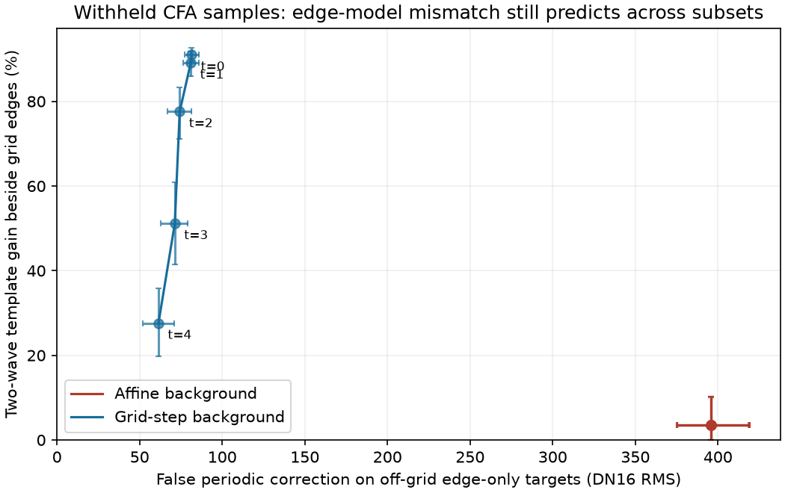

# Withheld CFA evidence still needs an adequate edge model

The first analytic prototype from the [weak-detail plan](weak-detail-literature-2026-11.md)
now separates candidate discovery from validation. **Independent withheld
samples reject the tested flat-noise candidates, but also validate periodic
approximations to a real edge.** A step nuisance model helps substantially on
its represented edge family. Slight geometry mismatch leaves large false
corrections. This is a diagnostic result, not a new demosaicing model or an
explanation proven for V200's building fringes.

The separate [shared-edge neural trial](experiments.md) is still training;
this diagnostic changes neither its frozen sources nor its review.

## Measured tradeoff

At the fixed descriptive threshold **both directional validation scores >2**,
the expanded test cohort gives:

| Exact procedural test | Affine nuisance | Grid-step nuisance |
| --- | ---: | ---: |
| Flat: false activations | 0/128 | 0/128 |
| Represented step, no waves: false activations | 128/128 | 0/128 |
| Off-grid step, no waves: false activations | 128/128 | 113/128 |
| Off-grid step: delivered false periodic correction RMS | 395.97 DN16 | 74.28 DN16 |
| One wave, no edge: delivered template gain | 100.56% | 98.37% |
| Two unequal waves, no edge: delivered template gain | 99.50% | 97.23% |
| Two unequal waves plus represented edge: delivered template gain | 3.50% | 77.58% |

Each condition has **64 scene seeds × two independent noise draws**. Repeats
within a scene are not independent sources. Source-cluster percentile bootstrap
intervals (5,000 draws) for the grid-step results are **66.99–81.41 DN16** for
off-grid false correction and **71.16–83.33%** for wave-plus-edge gain. The
off-grid false-activation interval is **80.47–94.53%**. Zero observed flat or
represented-step activations does not establish a zero population error rate;
the degenerate bootstrap interval for those counts supplies no such guarantee.



The curve sweeps the prespecified thresholds 0, 1, 2, 3 and 4. Its x-axis is
the periodic correction on **off-grid edge-only** targets, whose true periodic
increment is exactly zero. Its y-axis is projection onto the true two-wave
increment beside a **represented** edge. These are distinct procedural families,
not one combined image-quality score. RMS measures the delivered periodic
correction, not the total error of the fitted background plus correction.
Projection gain does not isolate the weaker second direction or prove correct
crossings, localization or color reconstruction.

## What is genuinely withheld

The prototype uses native128 RGGB sensor coordinates. A seeded partition takes
exactly half of each of the four Bayer phases for A; B is its complement.
Candidate discovery fits A-only per-color affine backgrounds, optionally with
one shared step geometry selected from 12 orientations × nine offsets using
only A's green samples. A-only green residuals select two native Fourier
frequencies between 1/64 and 0.24 cycles/pixel. Cosine/sine amplitudes and
nuisance coefficients are then jointly fitted per color on A. Green planes
are never resized or treated as coincident measurements.

The prediction is fixed before examining B. Its weighted squared-error reduction
against the A-only nuisance prediction is evaluated on B. Color-wise noise
variances use only A's sample means and the configured shot/read coefficients.
There is **no neural parent, DINO feature, GT subtraction, oracle variance map,
or full-input normalization** in discovery. The reverse fit uses B for discovery
and A for validation; the fixed rule requires both validation scores to exceed
the threshold. Neither validation side selects its predictor's frequencies,
phase, amplitude, window or threshold.

The score divides weighted SSE improvement by a nominal noise standard
deviation. Plug-in color-wise variances do not model the spatially varying
shot variance across an edge exactly. The reverse scores also need not be
independent of each other. These are empirically assessed scores, **not
calibrated probabilities, p-values or formal false-detail guarantees**.

Sensor draws use independent Poisson shot noise plus Gaussian read noise,
shot **0.00128**, read variance **6.5536e−6**. They omit ADC rounding, clipping,
black offsets and correlated noise. Targets have level0.02 and an optional
0.06 step, with color factors `[0.8,1,0.6]`. Sine amplitudes are0.0014 and
0.0007 with unknown random phases. Their native grid frequencies are fixed
to `(5,3)/128` and `(-4,7)/128`; the estimator searches the permitted spectrum
without receiving these frequencies. Off-grid edges shift angle by0.037 radians
and normalized offset by0.021 relative to the search grid.

Calibration/test scene and noise seeds are disjoint. An eight-source pilot
preceded this 64-source expansion; the expanded panel is exploratory development
evidence, not a blind generalization study. No threshold was optimized on
validation or test outcomes. Tests replace every withheld discovery pixel with
NaN and verify unchanged geometry, frequencies, coefficients and variance
estimates. They also check CFA phase balance, overlap rejection, predictable
fixed waves and an exactly represented noiseless step.

## Next implication

The useful next analytic comparison is finer A-only edge geometry and local
support, keeping the off-grid absent controls and weak second direction visible.
Merely increasing the withheld-validation threshold loses true wave response
while retaining substantial edge leakage in this prototype. The current
diagnostic therefore supports the plan's competing-edge investigation; it
does not justify installing a confidence gate in the neural reconstruction.
Nonperiodic fine structures, finite wires, gradients, different CFA patterns
and correlated sensor noise remain untested here.

[Full 3,072 fit records and threshold curves](results/withheld-cfa-v1/result.json) ·
[Source-cluster summaries](results/withheld-cfa-v1/summary.json) ·
[Exact source/evidence archives](results/withheld-cfa-v1/publication.json).
No original photos, protected GFX data or neural inference were used.

```bash
source scripts/env.sh
OPENBLAS_NUM_THREADS=1 uv run python scripts/diagnose_withheld_cfa.py \
  .cache/experiments/withheld-cfa-new --scenes 64
OPENBLAS_NUM_THREADS=1 uv run python scripts/report_withheld_cfa.py \
  .cache/experiments/withheld-cfa-new/result.json .cache/experiments/withheld-cfa-new-report
```
