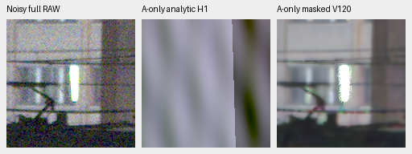
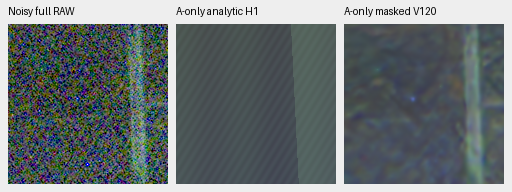

# An A-only neural background predicts complex held-out RAW structure better

On two reused GFX contexts, a frozen masked-input V120 predicts withheld sensor
samples better than the analytic H1 edge/wave fit. Building held-out sensor RMS
falls **5,031→1,889 DN16**; cab RMS falls **216→203 DN16**. The A-only neural
views still have blur/color artifacts. This supports testing a richer nuisance
model; it is **not a measured weak-detail reconstruction improvement** or a
new general denoising recommendation.

[Source, native coordinates and display metadata](images/withheld-neural-background-v1/manifest.json) ·
[Complete receipts, failed import and executed sources](results/withheld-neural-background-v1/publication.json).
[Independent native-display and import-recovery addendum](results/withheld-neural-background-v1/publication-addendum.json).

## Why test the background before adding more waveform capacity?

The [phase-aggregation comparison](phase-measurement-aggregation.md) increases
low-noise weak response while adding severe building bands. Consistent nuisance
projection changes little. A step/affine background plus two directions remains
a poor competitor for the real scene's windows, bars and occlusions: a detail
proposal can win validation by explaining structure omitted from that null.
The literature review explicitly proposes an A-only analytic nuisance first,
then a [masked neural baseline](weak-detail-literature-2026-11.md).

This diagnostic asks whether a frozen neural model, given **only discovery
samples**, supplies a better background predictor. It neither fits a new
network nor delivers a new correction above the full-input parent.

## Actual withholding, fresh DINO calls and fixed weights

Each native256 context uses the same deterministic split of half of every CFA
phase into A/B, then reverses it. Missing values are imputed using only A values
of the **same CFA phase**, by a normalized Gaussian with sigma1 packed pixel,
truncate3. Observed A values remain exact. A zero-denominator fallback uses
that phase's A-only mean. Variance input uses the original explicit shot/read
and the filled A-only signal proxy. Held-out values replaced by NaN produce
exactly the same neural input arrays and fingerprints.

V120's full neural path, including fresh DINOv3 encoding, runs once per fold:
**four root/four encoder forwards** total. No cached full-input parent feature
or RGB value enters inference. All91 restoration tensors are compared exactly
with V120 EMA before and after; the frozen backbone digest remains
`691963f0f796aac860d818d59d9d14287a4675612829fbe9467c7f5df8ce5b14`.
V120 checkpoint SHA256 is
`a9d9b6b4f974e24a6b11e5e740aab32314233a7f53c056cf37c7d2aac1c589fb`.
All four predictions close before held-out residual evaluation. There is no
GT/reference array read, optimizer update, new corruption or original RAW decode.

The same A data fits the analytic H1 competitor and its plug-in variance proxy.
Both predictions are upper-clipped at sensor white for the sensor comparison;
ordinary negative read-noise observations are retained. Metrics use B only and
are repeated in the reverse fold. This is prediction of **noisy same-capture
measurements, not exact GT**. The independent ISO100 captures/JPEGs are neither
loaded nor used as numerical targets.

## Results and limits

Each case pools65,536 held-out sensor observations over the complementary folds,
with colors weighted by their actual sample counts. The standardized error
uses the same A-only analytic variance proxy for both methods; it is an
empirical unit, not calibrated uncertainty.

| Retained context | Method | Held-out sensor RMS DN16 | Mean squared error / A proxy variance |
| --- | --- | ---: | ---: |
| Building | Analytic H1 |5,031.42 |87.2265 |
| | Masked V120 |1,889.30 |16.3008 |
| Cab, nearby profile | Analytic H1 |216.34 |1.4323 |
| | Masked V120 |202.72 |1.2976 |

The building remains poorly predicted even with the neural baseline. The cab
gain is modest. These two adaptively reused contexts do not establish detector
calibration, general camera performance, complete mesh recovery or improved
delivered RGB. Filled inputs have correlated noise and a different sampling
law from normal V120 inputs; the original shot/read coefficients do not model
all of that difference. A background used in a later correction still needs
its own matched control and error/false-detail review.

Noisy full RAW Malvar → A-only analytic H1 → A-only masked V120. Each cell is
160×160 unchanged pixels from native256. No GT/reference is shown.

The main DSCF3879 building view uses retained-context ROI
`[76,260,160,160]`, the previously observed maximum-correction failure, from
native256 tile origin `[28,212]`. Shot/read are `.00128/6.5536e-6`, display
exposure4/contrast1. The analytic view misses most actual geometry; the neural
view recovers more structure but retains highlight/color artifacts and softness.

The DSCF3842 cab view uses the standing left ROI `[206,229,160,160]` in its
retained native768 context, native256 tile origin `[158,181]`. Shot/read are
`.0014635775921166604/1.0715704128646712e-6`, exposure16/contrast1. Actual native
offsets determine the shifted CFA layout. Both methods retain substantial
detail loss; the neural view has mottle and small color artifacts. Saved
per-case WB/matrix and clipped-sRGB display are identical across methods.
Both PNGs were actually viewed. All protected captures/JPEGs/siblings remain
outside training, with original media read-only.

The CPU-only audit recomputes48 metric fields with maximum discrepancy
`4.55e-12`, checks all four input fingerprints and finite native FP32 outputs,
and verifies actual H1 invariance to withheld NaNs. It performs no neural work.
It reconstructs the same frozen H1 fitter/proxy, not an independent geometry
implementation. The working run takes82.11s including loading under concurrent
V132 training; this is not a speed benchmark.
An additional independent channelwise display check matches all460,800 native
RGB channels in both encoded boards exactly, with no extra inference or GT read.

The first launch failed before any model/encoder forward because the documented
`from demosaic.models import load_model` entry point was not exported. The
public package now exports it lazily; the import/native-pixel test passes without
importing Torch. Original failed source/logs remain intact; the working second
run has a separate frozen source/plan and the exact four-forward count above.
That package recovery changes only `models/__init__.py`; all other frozen
package/entry-script bytes match the failed attempt exactly.

The next matched correction test should compute A-only neural backgrounds on
whole cached contexts with one shared global CFA partition. Overlapping
analytic tiles must use that same partition, so their neural nuisance cannot
see samples reserved for validation. Fit its nuisance coefficients on A, keep
the proposal/threshold controls fixed, then measure actual weak-increment and
absolute false-detail errors. These two-context background scores alone do
not select or validate that future reconstruction model.

The [whole-context matched correction pilot](neural-nuisance-reconstruction.md)
now implements that shared-partition test, with a separate control for
conditional prediction delivery. Its completed audit/native review finds lower
added quiet/building error but lost clearest-prior weak recovery,3.69%→0.90%.
The backgrounds predict sensor structure better without supplying clean new
weak detail in that correction.
