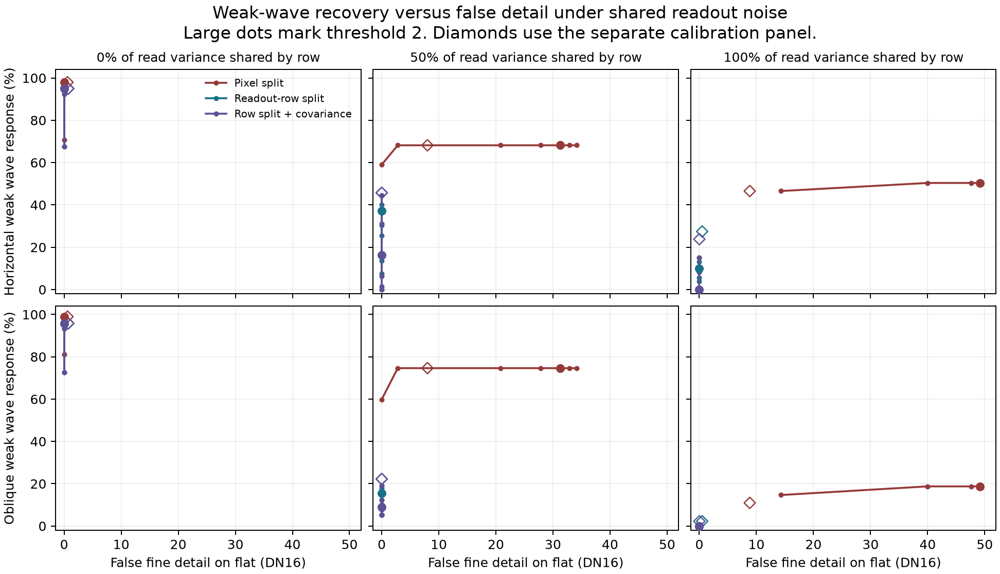
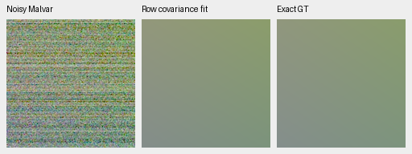
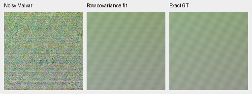

# Weak-detail validation under shared RAW readout noise

Disjoint Bayer pixels can share the same readout noise. With half
the simulated read variance shared across a physical row, the
usual pixel split approves false bands in **85 of 96** smooth
controls at its nominal cutoff. Holding out complete rows rejects
all 96. The safer split also reduces mean weak horizontal response
from **68.18% to 37.28%**. A separate calibration panel shows that
raising the ordinary pixel threshold also has substantial detail
costs when a strong edge is present. These are sensor stress tests
with exact constructed targets. [Sources and evidence](results/withheld-row-noise-v1/publication.json).

## Same marginal variance, different dependence

The test retains the ISO6400 configuration of shot `0.00128` and
read variance `6.5536e-6`, and adds 16-bit ADC quantization with
black fraction 0.03. A single Gaussian offset is shared by all
the measurements along a native row. The independent read component
supplies the remaining variance. Pointwise pre-ADC variance is
constant across the 0%, 50% and 100% sharing settings at the same
intensity, as are the paired Poisson draws. Complete rows have
independent offsets in this simulator.

The two sample splits keep exactly half the native measurements
of each Bayer phase. The pixel split samples throughout the crop.
The row split sends an entire pair of adjacent native rows to one
side. Randomizing row pairs keeps the four phases balanced. Each
side fits its background, phase and amplitude without using
the other side. A two-direction gate checks both predictions.
The covariance-adjusted arm uses the same complete-row fit and
scales its score by the known row covariance. It accounts for
repeated row contributions in the score variance while leaving
frequency and amplitude estimates fixed.
[Candidate fit](../src/demosaic/experiments/evaluation/withheld.py) · [Frozen plan](results/withheld-row-noise-v1/plan.json).

The 24 calibration and 48 test sources use independent seed banks.
Each source supplies five scene types, two noise draws and three
read fractions. All four Bayer layouts appear equally often.
Smooth controls are sloped planes with zero true periodic texture.
Off-grid steps test the same issue next to a sharp edge.
The three true-signal families pair a stronger oblique wave
with a weaker oblique or horizontal wave, including horizontal
detail beside an edge. Independent checks verify the read covariance,
ADC codes, exact balance across CFA phases and the reconstruction
of the score variance from a dense covariance matrix.
[Verification](results/withheld-row-noise-v1/verification.json) · [Sensor checks](results/withheld-row-noise-v1/sensor-check.json).

## Recovery and false texture at the same descriptive cutoff

Both directions must score above 2. Weak response is the signed
projection onto the true weak wave, including zero correction when
the gate rejects a crop. Counts are over 96 noisy observations of
48 source scenes for each role and read fraction.

| Read variance shared per row | Validation split | Smooth false accepts | Off-grid edge false accepts | Oblique weak response | Horizontal weak response | Horizontal beside edge |
| --- | --- | ---: | ---: | ---: | ---: | ---: |
| 0% | Pixel | 0/96 | 0/96 | 98.97% | 97.95% | 87.35% |
| 0% | Complete rows | 0/96 | 0/96 | 95.80% | 94.99% | 76.07% |
| 50% | Pixel | 85/96 | 37/96 | 74.62% | 68.18% | 66.44% |
| 50% | Complete rows | 0/96 | 0/96 | 15.59% | 37.28% | 20.96% |
| 50% | Complete rows, known covariance | 0/96 | 0/96 | 8.99% | 16.24% | 13.82% |
| 100% | Pixel | 96/96 | 92/96 | 18.75% | 50.38% | 52.06% |
| 100% | Complete rows | 0/96 | 0/96 | 0.00% | 10.06% | 5.68% |
| 100% | Complete rows, known covariance | 0/96 | 0/96 | 0.00% | 0.00% | 0.00% |

At 50% sharing the pixel split leaves **31.23 DN16** of mean
false periodic RMS on smooth controls. The row split removes this
correction while weakening real responses. At the more conservative
pixel cutoff of 8, both smooth and edge false accepts drop to zero
in this 50% setting. Pixel validation then gives 59.86% oblique
and 59.05% horizontal response on unoccluded waves. Beside the
edge it gives 13.55%, compared with 20.96% at cutoff 2 for the
row split at the same observed null counts. At 100% sharing the
pixel cutoff of 8 still approves 23 smooth and four edge controls.

The separately calibrated thresholds use the higher empirical
95th percentile of smooth and edge calibration scores for each
method and read fraction. In the fully shared setting this gives
14 smooth false positives for the pixel split with 46.56%
horizontal response. Complete rows with the covariance score give
zero observed smooth and edge false accepts and 23.81% horizontal
response. This is descriptive stress evidence with source-level
intervals, rather than a camera confidence threshold.
[All response curves and per-source intervals](results/withheld-row-noise-v1/summary.json).

## Native crop evidence

The triplets use synthetic BGGR sources, fixed native ROI
`[0,0,160,160]`, identical exposure ×16, identity white balance
and matrix, and the same sRGB encoding. Each shows noisy Malvar,
the covariance-adjusted fitted Bayer prediction displayed through
Malvar, and exact clean RGB. The numerical metrics score the measured
Bayer sites. These fits use no neural checkpoint.
[Native coordinates, seeds and viewing notes](results/withheld-row-noise-v1/viewing.json).

With 100% read sharing, source 8054933609 draws visible horizontal
bands under pixel validation. The complete-row audit leaves the
smooth control flat. The corresponding edge control also loses the
bands and retains its edge, with a slight change at the boundary.
[Smooth comparison](images/withheld-row-noise-v1/flat-largest-removed-comparison.png) · [Edge comparison](images/withheld-row-noise-v1/edge-largest-removed-comparison.png).

At 50% sharing, source 8054933642 is the retained oblique crop
where the row split raises response most at cutoff 2. The secondary
wave becomes visible, with softer crossings than the exact target.
For the horizontal-wave loss at 100% sharing, the same audit
suppresses the true weak and strong wave delivery.
[Oblique comparison](images/withheld-row-noise-v1/oblique-largest-gain-comparison.png) · [Horizontal loss](images/withheld-row-noise-v1/horizontal-largest-loss-comparison.png).

The [cached GFX sky check](gfx-noise-correlation.md) found no clear
evidence of dependence at its tested offsets. This stress panel
changes no real-camera noise estimate or default. Its large known
row fractions show how a biased confidence test could arise in a
different acquisition. A row-block fallback alone trades away
too much true texture to justify general use.
